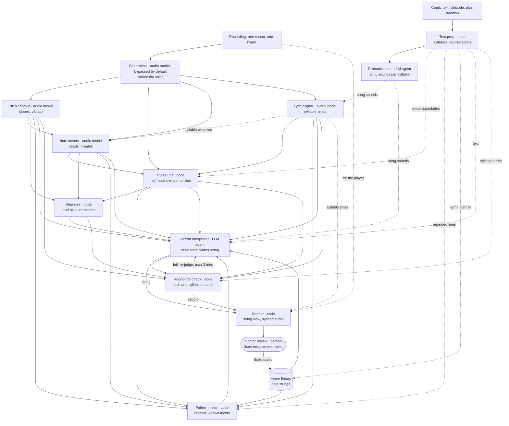

# Design context

These are the decisions from the Claude chat that designed this system. PLAN.md refers to them, so read this first.

## 1. What hazzat is

Hazzat (singular hazza) are the melodic movements of a Coptic hymn. The word also names the simple notation cantors use to map those movements, often called hymn maps. Coptic chant is passed down orally by trained cantors, so hazzat is a memory aid, not an exact score; learners read it while listening to a recording.

How hazzat is read, paraphrased from Coptic Cantor's guide (https://www.copticcantor.com/how-to-read, which has examples):

- Follow the text's direction (Coptic and English left to right, Arabic right to left). Within each stack of marks, read from bottom to top.
- A mark's length is how long the note is held. Half, full and double are relative to each other within a hymn, or a part of it, not fixed durations.
- A dot is a pause or breath of about one full note; several dots mean that many.
- A tilde (~) is a vibrating note, sometimes written as about three stacked short notes; ~~ lasts two notes.
- Notes in parentheses marked ×n repeat n times, either at the same pitch or rising or falling with each repeat.
- Up and down arrows move to a higher or lower note.
- A forward arrow means the underlined part is sung quickly, in about one note's length.
- A wave-like arrow (↝) moves to the next stack quickly or abruptly.
- A bracketed set labelled ① can be referred to elsewhere; a later [...]① means repeat that set exactly.
- A red letter is a sound that is sung but not written in the Coptic text; a gray letter is written but silent, usually in Greek words.
- A letter repeated in parentheses reminds the singer which vowel is being sung: carried across a line break, or a return to the true vowel after it drifts.

The key limitation: hazzat say only higher or lower, never by how much, and lengths are relative. The string notation must not look more precise than its source.

## 2. String notation (the output)

One continuous line per phrase, read in the text's direction, with the lyrics underneath. Vertical levels mean "a step higher or lower", not absolute pitches. Lengths are proportional to the hymn's half-note unit.

| Hazzat sign | String form |
| --- | --- |
| Stack, bottom to top | The string runs left to right (mirrored for Arabic) |
| Mark length | Length along the string, in half-note units |
| Each separate mark (a new note) | A bead at the start of each note, including a re-sung note on the same level |
| ↑ ↓ arrows | A smooth slope up or down: one level per hazzat arrow, or n levels when the audio measures a clearly larger leap (for example, at least 1.5 steps) |
| ↝ abrupt move | A sharp corner: a vertical jump with no slope, whatever the size. A wide leap alone is never drawn as a corner. With no change of level it is a short tick across the string. |
| ~ vibrating note | A wavy stretch |
| . pause | A dotted, silent stretch, with a breath mark above it |
| → sing fast | A thin dashed stretch, with the lyric underlined |
| ( )×3 repeat | Written out in full under a bracket labelled ×3, with ↗ or ↘ if each repeat rises or falls. Lyric labels go on the first copy only. |
| [ ]① reference | The same colour and a ① label at every occurrence: the same shape at the same starting level |
| No hazzat sign | The same shape at another level: the motif's colour, with the shift in its label, such as ①+1. This is an extension hazzat can't express. |
| Vowel in ( ) | A vowel label such as (a) under the string where the vowel carries on |
| Red and gray letters | The same colours in the lyric line |
| Text direction | The drawing's direction; mirrored for Arabic |

A single line has to solve four problems; these are the chosen answers:

- Where notes split on a level stretch: beads.
- Pauses without breaking the string: dotted stretches.
- An ordinary step versus an abrupt move: a slope versus a corner.
- Repeats: written out under a bracket, never looping the string back on itself.

Without lanes, rhythm is harder to see at a glance, so lengths stay strictly proportional. Faint beat ticks along the string are an optional extra.

## 3. The demo phrase (acceptance case for the renderer)

An invented phrase, not a real hymn line, that uses every rule at least once. `reference/string_demo.svg` is the agreed drawing of it. Levels run from 0 (lowest) to 3; lengths are in half-note units (half = 1, full = 2, double = 4).

| # | Lyric | What happens | Level | Length |
| --- | --- | --- | --- | --- |
| 1 | A | Motif ① starts with a note | 1 | 2 |
| 2 |  | Step up | 2 | 1 |
| 3 |  | Step down; motif ① ends | 1 | 1 |
| 4 | lē | Step up into a vibrato note | 2 | 2 |
| 5 |  | Breath | (silent) | 2 |
| 6 | lou | Repeat ×3, rising: step down, then each repeat a step higher | 1, 2, 3 | 1 each |
| 7 | i | Fast note on the same level (new bead, lyric underlined) | 3 | 1 |
| 8 | a | Note | 3 | 2 |
| 9 |  | Abrupt move down, then motif ① again | 1, 2, 1 | 2, 1, 1 |
| 10 |  | Step down to a held note; vowel label (a) under the melisma | 0 | 4 |

The lengths in this table are authoritative, and the renderer draws them strictly proportional. The SVG is only a style reference: its spacing is not proportional (half notes span 11 to 14 px, full notes 25 to 31 px).

Look used in the demo (a starting point, not a spec): 3 px stroke with round joins; motif notes purple (#7F77DD), other notes teal (#1D9E75); beads are 3 px radius dots; levels 20 px apart; a full note about 25 px long; pauses dotted in gray.

## 4. The agent graph (approved)

Dotted edges carry information from the text.

What each node is for:

- **Separation**: one node with three backends chosen by a setting: `bypass` (the default for now), `demucs` and `roformer`. Version 1 skips separation; when bypassed, pitch and pulse run on the full mix. A separation backend also keeps the accompaniment, for cymbal hits.
- **Text prep**: normalises the Unicode, covers both letter blocks, expands overlined abbreviations, adds the vowel a jinkim implies, splits syllables, marks Greek words and finds repeated lines and verse boundaries.
- **Pronunciation**: for each syllable, the sounds sung in the chosen tradition, a romanised form for the aligner, and flags for letters likely silent (gray) or added (red).
- **Lyric aligner**: forced alignment of known syllables, not speech recognition. The catch-all token is torchaudio's star token. It absorbs audio that isn't in the text, such as repeated words or an extra "Allelouia". It gives a confidence per syllable.
- **Note onsets**: works inside each syllable window, so it only has to find the notes within each vowel. It must not use the pulse unit (for example in breath thresholds), because pulse runs after onsets and that would make a cycle.
- **Pulse unit**: measures the half-note size per section. It defaults to one section per hymn, split at verse boundaries from text prep or at long pauses.
- **Step size**: measures how big one level is, once per section, from the intervals between adjacent stable notes. The interpreter and round-trip check both use it.
- **Pattern miner**: repeated text, such as a refrain or verses sung to one tune, is a strong hint that the melody repeats.
- **Hazzat interpreter**: makes the cantor-like calls (a wobble or three short notes? a true repeat or a near match? which formulas get a motif tag?) and writes the string. It sees a plot of the pitch line per syllable, not raw audio.
- **Round-trip check**: redraws the string as a pitch line and compares it with the recording, and checks every syllable appears once, in order. It refits the step size and reports any drift from the estimate. A failing section goes back to the interpreter with the error.
- **Cantor review**: each fix becomes a worked example stored in the hymn library for that hymn.

## 5. Coptic text handling

The owner's texts are in Unicode Coptic, not a legacy Coptic font.

- Coptic letters span two Unicode blocks: the Coptic block (U+2C80–U+2CFF), and seven Demotic-derived letters (ϣ ϥ ϧ ϩ ϫ ϭ ϯ) in the Greek and Coptic block (U+03E2–U+03EF). Every rule and regex must cover both; normalise (NFC) before matching.
- Abbreviations use U+0305 COMBINING OVERLINE. Abbreviated sacred names are read in full, so expand them from a lookup table before syllabifying or aligning.
- The jinkim marks a letter that forms its own syllable; on a consonant it implies an unwritten vowel, so ⲛ̀ⲧⲉ is read "ənte". Check how the owner's texts encode the jinkim before writing rules.
- Two pronunciation traditions are in use: Greco-Bohairic (from the 1858 reform, supported by the Church) and Old Bohairic (systematised by Emile Maher Ishak in 1975). Some letters differ: ⲃ, for example, is v or b in Greco-Bohairic, but w, oo or b in Old Bohairic. The owner will say which one their cantor uses.

Sources: https://en.wikipedia.org/wiki/Coptic_script and https://en.wikipedia.org/wiki/Bohairic_Coptic

## 6. Models and tools chosen

| Node | Choice | Notes |
| --- | --- | --- |
| Separation | `bypass` in version 1. When needed: `audio-separator` 0.24.1 with a RoFormer vocals model, then Demucs 4.1.0, then another machine with cached stems | The owner's Intel Mac caps PyTorch at 2.2.2. 0.24.1 is the last `audio-separator` without a PyTorch 2.3 floor, and it is untested on 2.2.2. Demucs 4.1.0 allows PyTorch 2.1 to 2.2 on Intel Macs. Needs ffmpeg. https://pypi.org/project/audio-separator/ |
| Pitch contour | RMVPE | Built for vocal pitch and robust to noise; an ONNX port runs with onnxruntime at 10 ms frames: https://huggingface.co/Scicom-intl/rmvpe-onnx. Lighter fallbacks: CREPE, pYIN (librosa). |
| Pulse unit | Own code, plus Beat This! for cymbal hits | https://pypi.org/project/beat-this/ |
| Lyric aligner | torchaudio 2.2.2's `MMS_FA` pipeline with `torchaudio.functional.forced_align` and its star token | Meta's MMS, by way of romanisation. It has Intel Mac builds for Python 3.10 to 3.12 and pins torch 2.2.2. It stays behind the aligner node's interface, because torchaudio removed this API in 2.9. The weights are CC-BY-NC 4.0, non-commercial. |
| Agents | Claude, through the Anthropic Python SDK | Key from `ANTHROPIC_API_KEY`; model name pinned in one config value; every call recorded and replayable. |

Why the agents don't listen to the audio: PitchBench, a 2026 benchmark, found current audio-language models don't hear pitch reliably, even on simple synthetic tones (https://benchmarklist.com/benchmarks/pitchbench/). So specialist models measure the audio, and the LLM reasons over text, numbers and plots.

Prior work worth reading:

- STRUM, a multi-stage pipeline from audio to rhythm-game charts, with per-component metrics and an explicit "operating envelope" of recordings it works on: https://arxiv.org/html/2605.12135
- CEAP, a tool for Old Hispanic chant, whose notation also records only up-and-down movement; it finds patterns recurring within and across chants: https://research-information.bris.ac.uk/en/publications/chant-editing-and-analysis-program-a-tool-for-analyzing-liturgica/
- A Leiden study finding that Coptic melodies are built from recurring formulas: https://scholarlypublications.universiteitleiden.nl/access/item%3A2920736/download
