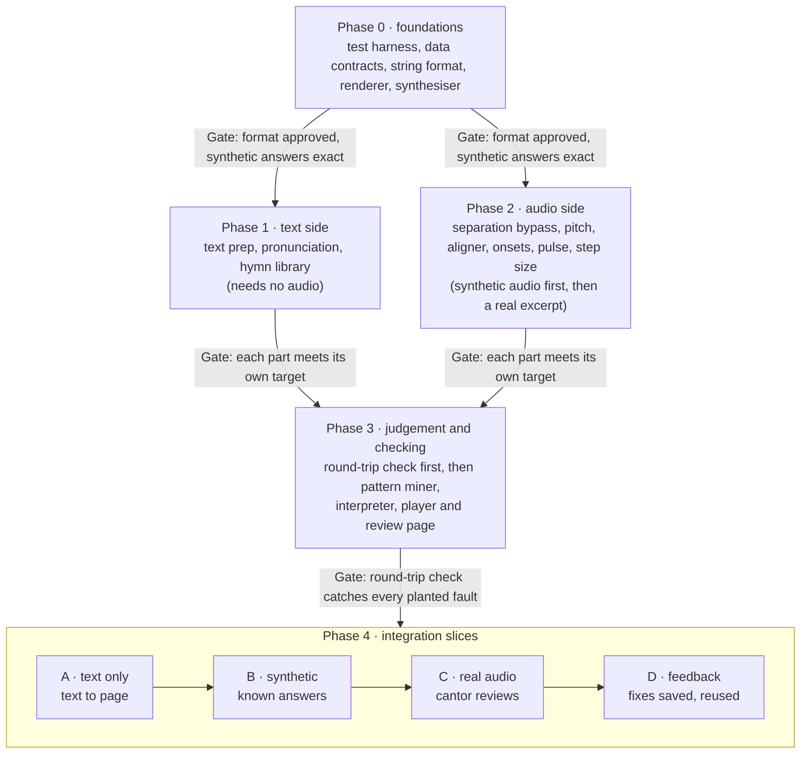

# Coptic hymn to string notation: build plan

> Exported on 1 Nov 2026 from the Claude doc of the same name (https://claude.ai/artifact/TP6SY7ru2vz55c4F6VyoKT).
> In this plan, "I" and "my workspace" mean the Claude that drafted it, in a cloud workspace; "you" is the repo owner.
> On the owner's Mac, read "Where each part runs" as: use the "On your computer" column.
> The build-order diagram is redrawn below as Mermaid.
> Edited here after export with the owner's Phase 0 decisions, so it now differs from that doc.

## Goal and approach

Version 1 turns one recording of a solo cantor, plus its Unicode Coptic text, into a string-notation page, synced to the audio, that a cantor can correct. Choirs, Arabic and English texts, and live use come after version 1.

The build follows five rules:

- One module per node in the agent graph, each runnable on its own from the command line.
- The data passed between nodes is fixed in Phase 0 and checked at every edge.
- A part joins the system only after it meets its own pass criteria.
- Integration happens in thin end-to-end slices, each adding one or two parts to a chain that already runs.
- Every LLM call is recorded, so tests replay at no cost and give the same answer each time.

Synthetic audio made from known strings gives exact answers for testing. That lets most parts be finished before any real recording is labelled.

## Build order at a glance

Phases 1 and 2 are independent and can run side by side; Slice A can start as soon as Phase 1 passes.

## Phase 0: foundations

Phase 0 builds what every later part depends on: the data contracts, the string format and a synthesiser that makes test audio with known answers. It needs nothing from you except one review of the string format.

1. **Test harness.** A Python package with one folder per node, a command-line runner and pytest. Done when: an empty node runs end to end through the harness.
2. **Data contracts.** Typed schemas for what each node passes on: syllables, sounds, pitch track, pulse unit, note starts, syllable times, patterns, the string itself and review records. Done when: each schema has an example file and a validation test.
3. **String format.** A text form of the string notation, with a parser, a writer and a validator; each hazzat rule maps to one token type. The canonical text is ASCII, hazzat signs are accepted as input aliases, and the writer always outputs the canonical form. Done when: every rule has a canonical example that survives parse-then-write unchanged, one test shows hazzat-sign input normalises to the canonical form, and you have approved the format.
4. **Renderer.** Draws a string as the string view we designed, in hazzat signs, with a mirrored layout for Arabic. Lengths are strictly proportional; the SVG is only a style reference. Done when: the demo phrase from our chat renders from its text form, locked by snapshot tests.
5. **Synthesiser.** Turns a string into a vowel-like sung tone, with settings for tempo, step size, vibrato, noise, room echo and cymbals. It also writes the true pitch track, note starts, syllable times, pulse unit and step size. Done when: those true values match the string exactly for 50 random strings.

The synthesiser is the key test tool: it gives every audio part exact answers long before real recordings are labelled. Real recordings still decide the final quality, from Phase 2 on.

## Phase 1: text side

Phase 1 builds the text branch, which needs no audio and can run alongside Phase 2.

1. **Text prep (code).** Normalises the Unicode, covers both Coptic letter blocks, expands overlined abbreviations from a lookup table, adds the vowel a jinkim implies and splits syllables. It also marks Greek words and finds repeated lines. Tested with: tables of tricky cases, plus 50 lines from 5 hymns with syllables counted by hand. Done when: every count matches; any mismatch is a rule to fix.
2. **Pronunciation agent (LLM).** A rule table per tradition handles regular letters, and the LLM handles exceptions such as Greek words and word-specific sounds. For each syllable it outputs the sung sounds, a romanised form for the aligner, and flags for silent or added letters. Tested with: about 200 words checked by a cantor in your tradition. Done when: at least 95% match, every output passes its schema, and reruns give identical answers.
3. **Hymn library (code).** Stores approved strings and corrections per hymn, keyed by a fingerprint of the text so small spelling differences still find the right hymn. It starts as a folder of JSON files. Done when: variants of one hymn find the same entry, and different hymns never do.

## Phase 2: audio side

Phase 2 builds the six audio parts in data order; each is tested first on synthetic audio, then on one hand-labelled real excerpt.

1. **Separation (audio model, skipped in version 1).** One node with three backends chosen by a setting: `bypass` (the default for now), `demucs` and `roformer`. Version 1 builds only the bypass; pitch and pulse then run on the full mix. When separation is needed, try `audio-separator` 0.24.1 on PyTorch 2.2.2 first. If it fails, use Demucs 4.1.0. As a last resort, separate on another machine and cache the stems. Tested with: synthetic voice mixed with cymbals and room echo. Done when: the bypass passes the full mix through unchanged, and any separation backend keeps pitch error within 10 cents of the clean voice.
2. **Pitch contour (audio model).** RMVPE on your computer, CREPE or pYIN in my workspace, giving pitch every 10 ms with a confidence. A vibrato detector reports rate and width. Tested with: synthetic steps, glides and vibrato at several speeds and noise levels. Done when: median error is under 20 cents, and at least 90% of planted vibratos are found with under 5% false alarms.
3. **Lyric aligner (audio model).** The MMS forced aligner on your computer, with a catch-all token for audio not in the text; in my workspace, a fallback splits the audio by the known syllable count. It outputs each syllable's start, end and confidence. Tested with: 2 minutes of a real recording, with syllable starts tapped by hand on a page I build. Done when: median start error is at most 100 ms, and 90% of syllables land within 250 ms.
4. **Note onsets (audio model).** Inside each syllable, finds new notes from pitch changes and from re-sung notes on the same pitch, plus breaths. Tested with: synthetic audio with planted same-pitch repeats and breaths, then 30 seconds of hand-tapped real notes. Done when: F1 is at least 0.9 within 50 ms on synthetic audio.
5. **Pulse unit (code).** Estimates the half-note length per section from note durations, or from cymbal hits with Beat This! when cymbals are present. It defaults to one section per hymn, split at verse boundaries from text prep or at long pauses. Tested with: synthetic hymns at known tempos with up to 15% timing wobble. Done when: within 10% of the true unit in 95% of cases.
6. **Step size (code).** Estimates how big one level is, once per section, from the intervals between adjacent stable notes, and passes it to the interpreter and the round-trip check. Tested with: synthetic hymns at known step sizes with noise and drift. Done when: within 10% of the true step in 95% of sections.

## Phase 3: judgement and checking

Phase 3 turns measurements into notation and checks the result. The round-trip check comes first, because it grades the interpreter.

1. **Round-trip check (code).** Redraws a string as a pitch line, using the estimated step size and the pulse unit, and compares it with the recording. It refits the step size and reports any drift from the estimate. It also confirms every syllable appears once, in order. Tested with: correct strings, plus copies with planted faults such as a wrong step, a missing note or a swapped syllable. Done when: every planted fault fails and no correct string does.
2. **Pattern miner (code).** Finds exact and near repeats, including rising and falling ones, seeded by repeated text lines and known motifs in the hymn library. Tested with: synthetic hymns with planted repeats and look-alike distractors. Done when: at least 95% of planted patterns are found, and at least 95% of reported patterns are real.
3. **Hazzat interpreter (LLM).** Works one phrase at a time from a pitch plot per syllable, note candidates, the pulse unit, the step size, pattern candidates, the text and its sounds, and past strings from the library. It writes that phrase's string, which the parser must accept; a failed round-trip sends it back with the error, up to 3 times. It writes a move of more than one level only when the measured leap is clearly bigger than the section's step (for example, at least 1.5 steps), and an abrupt move only when the move is truly abrupt. Done when, on synthetic hymns: every output parses, at least 90% of tokens are correct, and at least 95% of phrases pass within 3 tries.
4. **Player and review page.** Shows the string in hazzat signs, synced to the recording, lets a cantor fix a phrase, and saves the fix to the hymn library in the canonical text. Done when: a fix made on the page appears in the next run's library lookup.

## Phase 4: integration slices

Integration happens in four slices, each a runnable end-to-end chain that grows by one or two real parts.

1. **Slice A, text only.** Coptic text goes through text prep and pronunciation, under a hand-written string, to the renderer. It can start as soon as Phase 1 passes. Done when: one real hymn renders with correct syllables under its string.
2. **Slice B, synthetic audio.** The synthesiser makes audio from a known string, and the chain runs from pitch through the interpreter to the renderer. Syllable times come from the synthesiser at first, then from the aligner. Done when: output strings match input strings on 20 synthetic hymns, with at least 90% of tokens correct.
3. **Slice C, your recording.** Adds the real aligner, with separation still bypassed, runs on your recording, and the cantor reviews the result. Done when: every phrase passes the round-trip check or is flagged, and each correction is traced to the node that caused it.
4. **Slice D, feedback loop.** Fixes from the review page go into the hymn library, and a second run uses them. Done when: a second run of the same hymn needs fewer corrections than the first.

After Slice D, the work widens to more hymns and cantors, with a short note kept of which recordings work well and which do not.

## Testing and metrics

Every part is tested in four layers, and a regression run after each change catches anything that gets worse.

- **Unit tests** check each module's logic with pytest.
- **Contract tests** check every input and output against the Phase 0 schemas.
- **Golden tests** lock outputs that must not drift, such as renderer snapshots and text prep tables.
- **Evaluation sets** score each node on synthetic hymns with exact answers, plus real excerpts labelled by hand or approved by a cantor.

LLM calls are stored under a fingerprint of the model, prompt and inputs. Tests replay the stored answers, so they are repeatable and free, and refreshing them is a deliberate step. The model version is pinned and its settings fixed.

A scoreboard page tracks each node's headline metric across runs, so a drop points straight at the part that regressed. The end-to-end metric is the share of syllables a cantor accepts without edits, measured from Slice C on.

## Where each part runs

Everything can be built and tested in my workspace except the stronger models, which download from Hugging Face, a site blocked there. One setting switches the code between the two.

| Part | In my workspace | On your computer |
| --- | --- | --- |
| Separation | Bypass only, unless its models download from GitHub (checked in Phase 2) | Bypass by default; `demucs` or `roformer` by setting |
| Pitch contour | CREPE or pYIN | RMVPE |
| Lyric aligner | Fallback that splits by syllable count | MMS forced aligner |
| Pronunciation and interpreter agents | Stored LLM answers | Live calls with your Claude API key |
| All other parts | Full | Full |

Your computer needs Python and ffmpeg; a GPU speeds up separation but is not required for short hymns. The MMS aligner is licensed for non-commercial use only, so it would need replacing before any paid use. Every other model's licence is checked when it is added.

## What I need from you

Phase 0 needs only one review from you; the first real input is hymn texts for Phase 1.

- [ ] Phase 0: approve the string format once I draft it.
- [ ] Phase 1: 3 to 5 hymn texts in Unicode Coptic, and whether your cantor uses Greco-Bohairic or Old Bohairic.
- [ ] Phase 1: a cantor's check of about 200 word pronunciations, from a list I prepare.
- [ ] Phase 2: one recording of a short hymn by a single cantor, with its text.
- [ ] Phase 2: syllable starts tapped along to 2 minutes of that recording, on a page I build.
- [ ] Phase 3 onwards: cantor time to review strings on the review page.
- [ ] Live runs: a Claude API key on your computer for the two agents.

## Risks and mitigations

The biggest risk is aligning syllables inside long melismas, so the plan tests it on real audio early, in Phase 2.

| Risk | Effect | Mitigation |
| --- | --- | --- |
| Syllables misaligned in long melismas | Notes land under the wrong syllable | Known syllable count, catch-all token, confidence flags, hand taps for the first hymns |
| Vibrato and quick repeated notes look alike | Wrong beads on the string | Interpreter sees plots, round-trip check, cantor rules saved to the library |
| Synthetic audio is too clean | Parts pass tests but fail on real voices | Noise, echo and drift in the synthesiser; real excerpts in every evaluation set |
| Cantors pronounce differently | Aligner confidence drops | Tradition set per cantor; low-confidence syllables flagged |
| Church acoustics: echo, cymbals, congregation | Noisy pitch track | Recording guidance, a note of which recordings work, and a separation backend when needed |
| Intel Mac caps PyTorch at 2.2.2 | Some model packages won't install | ONNX routes where they exist, separation bypassed in version 1, and the fallback order in Phase 2 |
| LLM answers drift | Same input gives different strings | Pinned model, stored answers, schema checks, regression runs |
| Strong models blocked in my workspace | Full quality testable only on your computer | Fallbacks here, same code path on your computer |
| Aligner licence is non-commercial | Blocks any paid use | Swap the aligner before charging for anything |
